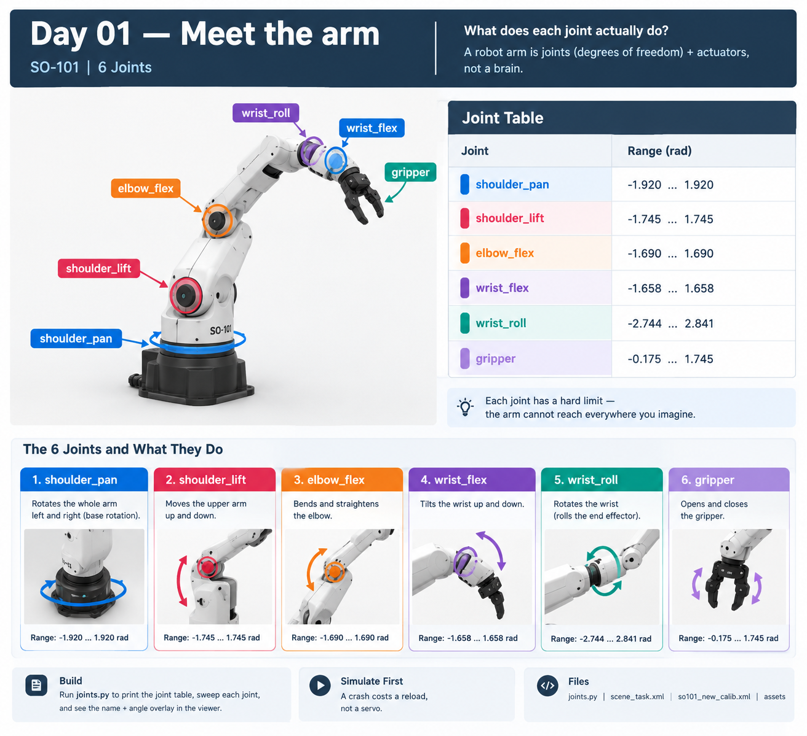

# Robotic Lab

One robot arm. One task a day. Every task is a GitHub issue that gets closed
with a working demo and a video.

An ongoing series in 30-day batches. Sim first (MuJoCo), hardware when it
arrives. When all 30 issues in a batch are closed, the next 30 get planned.

**Question this series answers:** how does a robot learn to do something, and
how does simulation connect to a real arm?

Base stack: SO-101 in [MuJoCo](https://mujoco.org), demonstrations recorded at
30 Hz, policies trained with [LeRobot](https://github.com/huggingface/lerobot).
Laptop for simulation, free Colab GPU for training.

## The board

All tasks live as GitHub issues, grouped into milestone phases.
**Start with the lowest-numbered open issue.**

- [Board](https://github.com/users/arundidauli/projects/3) - one card per day
- [Open tasks](https://github.com/arundidauli/robotic-lab/issues)
- [By phase](https://github.com/arundidauli/robotic-lab/milestones)
- [Hardware tasks](https://github.com/arundidauli/robotic-lab/milestone/7) (closed until the arm arrives)

| Phase | Days | Milestone | Focus |
|-------|------|-----------|-------|
| 1 | 01–05 | Foundations | Joints, forward kinematics, workspace, inverse kinematics |
| 2 | 06–10 | Scripted manipulation | Pick and place, failure analysis, cameras, teleop, dataset |
| 3 | 11–16 | Imitation learning | Dataset replay, ACT, evaluation, data-centric iteration |
| 4 | 17–21 | Robustness | Perturbation, randomization, latency, sim-to-real prep |
| 5 | 22–26 | Beyond behavior cloning | Multi-task, language, RL, VLA |
| 6 | 27–30 | Systems | Policy service, ROS 2, deployment harness, capstone |
| H | — | Hardware (when arm arrives) | BOM, calibration, safety, real deployment |

## Progress

### Day 01 — Meet the arm ✅



Six joints, six limits. The viewer labels each joint by name while it sweeps.
Code: [`days/day01-meet-the-arm/`](days/day01-meet-the-arm/) · [issue #1](https://github.com/arundidauli/robotic-lab/issues/1)

## How a day works

1. Open the next issue. It contains the task, the concept, the video script,
   and the done-check.
2. Do the task. Put runnable code in `days/dayNN-slug/`.
3. Record 30–60 s. Hook first, no intro.
4. Commit: `dayNN: <what changed>`.
5. Close the issue with the video link in a comment.

The issue is the source of truth until it closes. The folder is the evidence
that it worked.

## Repo layout

```
days/            one folder per completed day: README + code + small artifacts
  _template/     starting point for every new day
lib/             shared code that two or more days use
media/           gifs and stills for READMEs (no raw video in git)
```

Rules:
- Every day starts with a **question**, not a tool.
- Every claim in a video must be reproducible from the folder.
- No datasets or checkpoints in git — link to Hugging Face.
- Failed days get closed too, with the failure written down. Failure is content.

## Setup

```bash
git clone https://github.com/arundidauli/robotic-lab.git
cd robotic-lab
python3.12 -m venv .venv
.venv/bin/pip install -r requirements.txt
git submodule add https://github.com/TheRobotStudio/SO-ARM100 models/SO-ARM100
```

Day 1 is the first thing to run; each issue lists its own command.

## Batches

A batch is 30 closed issues. Then the next 30 are planned, informed by what
actually broke. Topics are not decided years ahead — only one batch ahead.

## Hardware

Hardware issues live in their own milestone and stay closed until an arm is on
the desk. They assume the simulator interface is already correct, so nothing in
them is guesswork by the time they open.

## License

Code MIT. The SO-101 model keeps its upstream license. Videos are linked,
not vendored.
