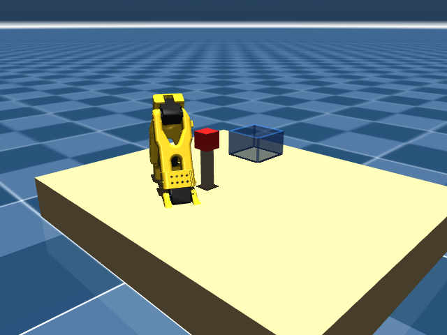

# Day 01 — Meet the arm


## Question
This robot has six joints. What does each one actually do?

## Task
1. Load the SO-101 in MuJoCo and print every joint: name, range, actuator.
2. Move one joint at a time through its full range, holding the others still.
3. Show the joint name and live angle in the viewer while it moves.

## What you'll learn
- A robot arm is joints (degrees of freedom) plus actuators, not a brain.
- Every joint has a hard limit — the arm cannot reach everywhere you imagine.
- Simulation first: a crash costs a reload, not a servo.

## Build
| File | What it does |
|------|--------------|
| `joints.py` | Loads the scene, prints joint table, sweeps each joint with a name + angle overlay |
| `scene_task.xml` | Task scene (table, cube, bucket, arm) |
| `so101_new_calib.xml` | SO-101 model include |
| `assets` | Symlink to `models/SO-ARM100/.../assets` for the STL meshes |

```bash
cd days/day01-meet-the-arm
../../.venv/bin/mjpython joints.py                  # viewer, close when done
../../.venv/bin/mjpython joints.py --auto-exit 45   # same, exits on its own
```

macOS needs `mjpython` for the live viewer. The headless renderer is not used
here; the viewer displays live joint names and angles during the sweep:



## The 6 joints and what they do

| Joint | Motion & Purpose | Range (rad) | Range (deg) |
|-------|------------------|-------------|-------------|
| `shoulder_pan` | Rotates the whole arm left and right (base rotation) | -1.920 … 1.920 | ~ ±110° |
| `shoulder_lift` | Moves the upper arm up and down | -1.745 … 1.745 | ~ ±100° |
| `elbow_flex` | Bends and straightens the elbow | -1.690 … 1.690 | ~ ±97° |
| `wrist_flex` | Tilts the wrist up and down | -1.658 … 1.658 | ~ ±95° |
| `wrist_roll` | Rotates the wrist (rolls the end effector) | -2.744 … 2.841 | ~ -157° … +163° |
| `gripper` | Opens and closes the gripper fingers | -0.175 … 1.745 | ~ -10° … +100° |

> **Key takeaway:** Each joint has a hard limit — the arm cannot reach everywhere you imagine. Five joints have roughly ±100° to ±160° range, while the gripper is the asymmetrical actuator.

## Video
- **0–15 s:** six joints sweeping one by one, name overlay visible. "This robot has six joints. Watch what each one does."
- **15–40 s:** the joint table on screen, point at the limits. "Five are roughly ±100°, the gripper is the odd one out."
- **40–60 s:** the full arm returning to rest. "No AI yet. Just motors."

Caption: Six joints, six limits, zero learning. Day 1 of building a robot that
teaches itself.

## Done when
- [x] `joints.py` runs on a clean clone.
- [x] Each joint visibly moves alone.
- [ ] Video posted and linked below.
- [ ] Issue #1 closed with video link.
- [x] Commit: `day01: joint sweep + limits table`

Video: _link_

## Time
2 h
