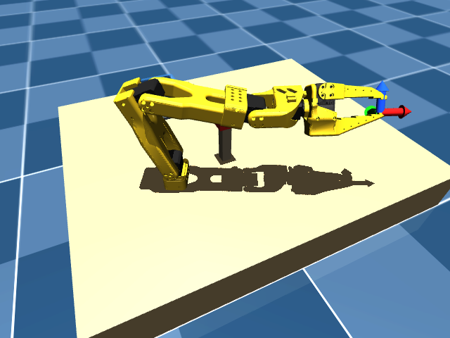

# Day 02 — Forward Kinematics & Gripper Frames



## Question
How does a robot know where its own hand is?

## Task
1. Compute gripper position and orientation from the joint angles using 4×4 homogeneous transformation matrices.
2. Draw the gripper coordinate frame ($X$=Red, $Y$=Green, $Z$=Blue) live in the MuJoCo viewer attached to the tool center point.
3. Print the pose for three representative configurations and compare against MuJoCo's ground-truth site pose (`gripperframe`).

## What you'll learn
- **Joint angles are inputs; hand pose is a computed output:** Servos only report internal motor angles; Cartesian 3D coordinates $(X, Y, Z)$ and orientations must be calculated analytically.
- **Frames chain together:** Each link's transformation multiplies the previous one ($T = T_0 \cdot T_1 \cdot T_2 \cdots T_n$).
- **The tool frame is not the wrist frame:** On the SO-101, the tool center point sits ~16 cm forward from the wrist hinge. Forgetting this offset means missing grasp targets completely.

## Build

| File | What it does |
|------|--------------|
| `fk.py` | Computes analytical FK via 4×4 matrix chain, verifies against MuJoCo site pose, and draws live RGB frame axes in the viewer |
| `scene_task.xml` | Task scene (table, cube, bucket, arm) |
| `so101_new_calib.xml` | SO-101 model include with `gripperframe` site |
| `assets` | Relative symlink to `models/SO-ARM100/.../assets` for STL meshes |

```bash
cd days/day02-forward-kinematics

# 1. Verification table only (headless, fast)
../../.venv/bin/python3 fk.py --no-gui

# 2. Interactive live viewer (macOS requires mjpython)
../../.venv/bin/mjpython fk.py

# 3. Timed run with automatic exit
../../.venv/bin/mjpython fk.py --auto-exit 10
```

## The Transform Chain

Each joint rotates around its local $Z$-axis by angle $\theta_i$, chained after the link's structural offset from its parent:

```python
# Transform chain: one line per joint
T_base     = self.T_world_base
T_shoulder = T_base     @ self.T_base_shoulder  @ rot_z_4x4(q1)
T_upper    = T_shoulder @ self.T_shoulder_upper @ rot_z_4x4(q2)
T_lower    = T_upper    @ self.T_upper_lower    @ rot_z_4x4(q3)
T_wrist    = T_lower    @ self.T_lower_wrist    @ rot_z_4x4(q4)
T_gripper  = T_wrist    @ self.T_wrist_gripper  @ rot_z_4x4(q5)
T_tool     = T_gripper  @ self.T_gripper_site   # tool center point offset
```

## Verification Table

Comparing analytical FK against MuJoCo's internal `data.site_xpos`:

| Configuration | Joint Angles (rad) | FK Hand Pos (m) | MuJoCo Site Pos (m) | Pos Error | Wrist $\to$ Tool Offset |
|---|---|---|---|---|---|
| **1. Home (Zeros)** | `[0.0, 0.0, 0.0, 0.0, 0.0]` | `[+0.3914, -0.0000, +0.2265]` | `[+0.3914, -0.0000, +0.2265]` | $< 10^{-16}\text{ m}$ | 16.05 cm |
| **2. Reach / Pick** | `[0.45, -0.35, 0.55, -0.25, 0.60]` | `[+0.3167, -0.1392, +0.2116]` | `[+0.3167, -0.1392, +0.2116]` | $< 10^{-16}\text{ m}$ | 16.00 cm |
| **3. High / Angled**| `[-0.75, 0.65, -0.45, 0.35, -1.10]` | `[+0.3180, +0.2696, +0.0814]` | `[+0.3180, +0.2696, +0.0814]` | $< 10^{-16}\text{ m}$ | 16.12 cm |

The position difference between analytical matrix chain multiplication and MuJoCo's C kinematics solver is below floating-point machine epsilon ($10^{-16}\text{ m}$).

## Video (30–60 s)

- **0–15 s:** RGB coordinate arrows glued to the moving gripper tip as it weaves through 3D space. *"How does a robot know where its hand is?"*
- **15–40 s:** Code walkthrough showing the transform chain. *"Motors only know angles. Hand position is calculated by chaining 4×4 matrices link by link."*
- **40–60 s:** The comparison table. *"Analytical math matches MuJoCo down to $10^{-16}$ meters. And notice the wrist-to-gripper offset: 16 centimeters. Code in repo."*

Caption: Joint angles are inputs, hand pose is math. Day 2 of building an autonomous robot arm from scratch.

## Done when
- [x] Task runs from a clean clone (`python3 fk.py --no-gui`).
- [x] Live RGB frame axes rendered in the viewer attached to the gripper.
- [x] Analytical FK matches MuJoCo site pose across test configurations.
- [ ] Video posted and linked below.
- [ ] Issue #2 closed with video link.
- [ ] Commit: `day02: gripper pose and frames`

Video: _link_

## Time
~2 h
