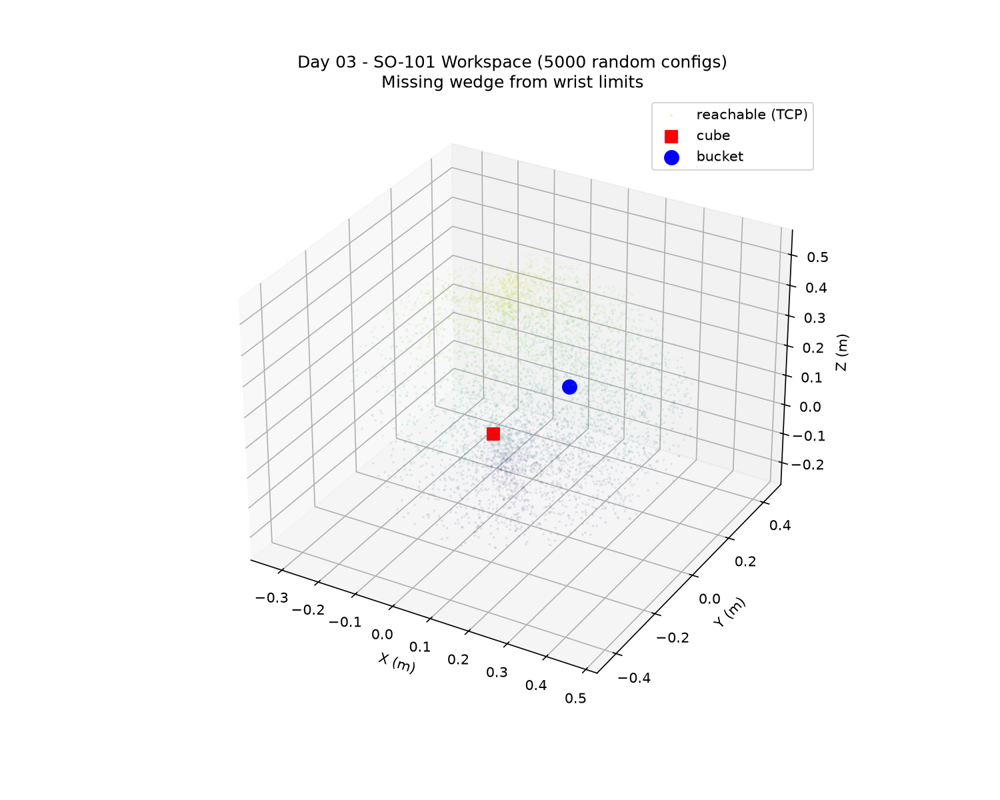

# Day 03 — Reachability and the missing wedge



## Question

Can the arm reach everywhere that looks reachable?

## Task

1. Sample 5,000 random joint configurations within limits.
2. Record the resulting gripper positions and plot the workspace.
3. Overlay the cube and bucket, then explain the missing wedge.

## What you'll learn

- Reachable is not the same as usable.
- The wrist limit carves a cone out of the workspace.
- Workspace plots are how you place objects instead of guessing.

## Build

| File | What it does |
|------|--------------|
| `workspace.py` | Samples random joint configs in limits, computes gripper TCP positions via FK/simulation, plots 3D workspace, overlays cube and bucket |
| `scene_task.xml` | Task scene (table, cube, bucket, arm) |
| `so101_new_calib.xml` | SO-101 model include with `gripperframe` site |
| `assets` | Symlink to `models/SO-ARM100/.../assets` for STL meshes |

```bash
cd days/day03-workspace-mapping
../../.venv/bin/python3 workspace.py
```

## Video

- **0-15 s:** the point cloud spinning
- **15-40 s:** the missing wedge, traced to the wrist limit
- **40-60 s:** cube and bucket inside the reachable region

Caption: 3 lines - the question, what worked, what broke.

## Done when

- [ ] Task runs from a clean clone
- [ ] Folder committed: `day03: reachability and the missing wedge`
- [ ] Video posted
- [ ] Issue closed with the video link in a comment

## Time

~2.5 h

Video: _link_
