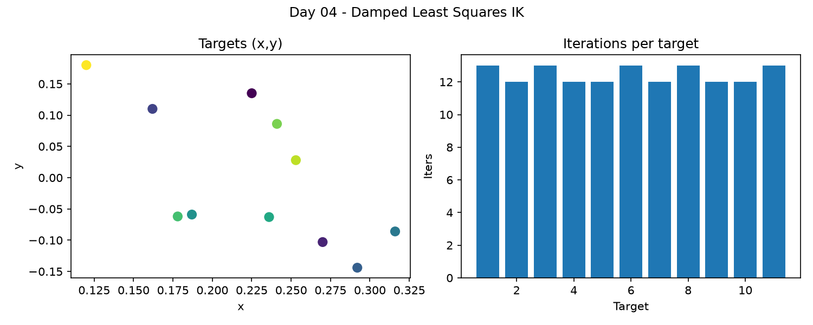

# Day 04 — Position-only IK



## Question

How do you tell the arm where to go?

## Task

1. Implement damped least-squares IK for position only.
2. Reach 10 sampled targets and log final error and iterations.
3. Show a target near a joint limit, where the solver oscillates.

## What you'll learn

- IK has no single answer - many poses reach the same point.
- Damping prevents wild jumps near singularities.
- Convergence is not success if the pose is unusable.

## Build

| File | What it does |
|------|--------------|
| `ik.py` | Damped least-squares position IK, Jacobian from MuJoCo, reaches targets and logs errors/iterations |
| `scene_task.xml` | Task scene (table, cube, bucket, arm) |
| `so101_new_calib.xml` | SO-101 model include with `gripperframe` site |
| `assets` | Symlink to `models/SO-ARM100/.../assets` for STL meshes |

```bash
cd days/day04-inverse-kinematics
../../.venv/bin/python3 ik.py --no-gui
../../.venv/bin/mjpython ik.py  # viewer
```

## Video

- **0-15 s:** a target sphere, arm reaching it
- **15-40 s:** the error curve over iterations
- **40-60 s:** the target that makes it oscillate

Caption: 3 lines - the question, what worked, what broke.

## Done when

- [ ] Task runs from a clean clone
- [ ] Folder committed: `day04: position-only ik`
- [ ] Video posted
- [ ] Issue closed with the video link in a comment

## Time

~2.5 h

Video: _link_
